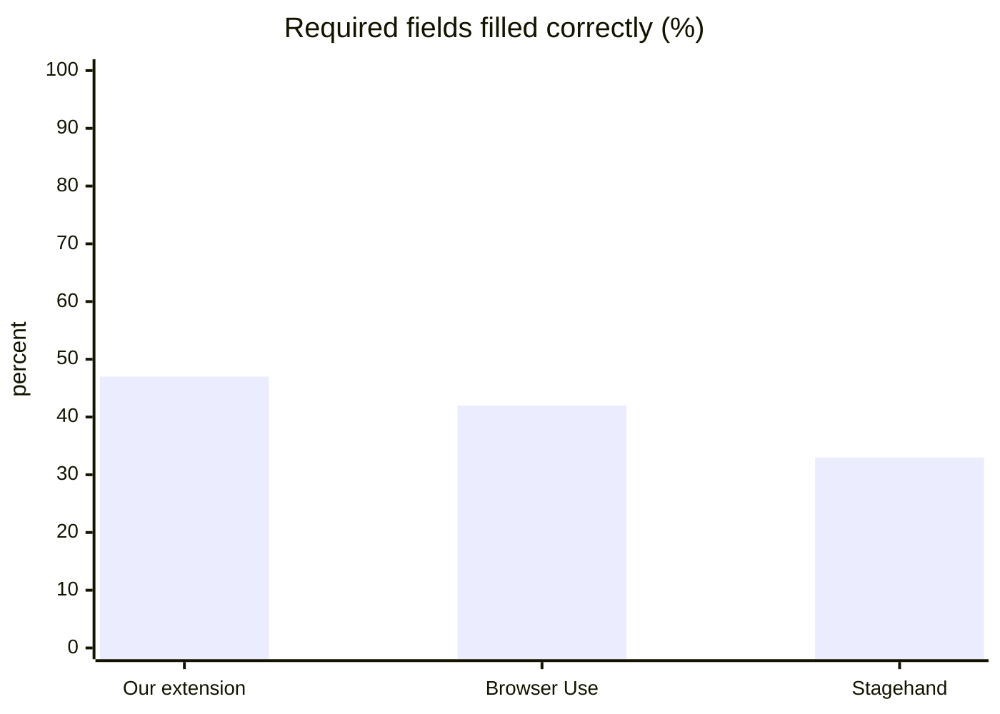
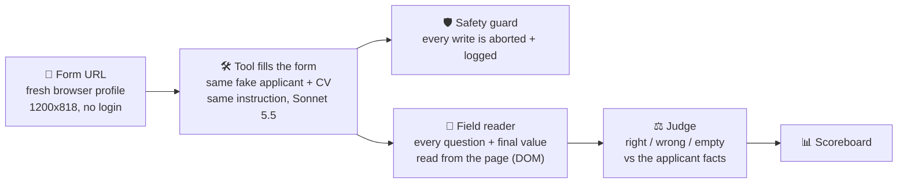

# 🥊 Job Pilotto bake-off

**Our job-application extension vs. the open-source browser agents** — same forms, same applicant, same scorer, same safety net.

    

> [!IMPORTANT]
> **TL;DR (13 Oct 2026): a tie, with a twist.** On 5 complete forms our extension fills **28 of 60** required fields correctly, Browser Use **25**, Stagehand **20**. All three leave about half of the required fields empty. Ours is also the fastest (48 s of its own work) and free on the plan; Stagehand costs ~$1.10 a form for the worst score. Nobody pressed *Submit* on a live form.

> [!WARNING]
> **The extension rows are the OLD build `62dad23`** (the primary checkout, 57 commits behind main). It lacks the fix that stops a contact detail going into a question. Re-runs on current main (`9a0416d`, own worktree) arrive as a second extension row. The agents' results are not affected, and every extension result now records its commit.

---

## 🏆 Scoreboard

<!-- RESULTS-START -->
| | Tool | Required fields filled correctly | Wrong values | Time per form | Cost per form | Forms |
| :-: | --- | --- | :-: | :-: | :-: | :-: |
| 🥇 | **Our extension** <sub>old build</sub> | 🟢 `▰▰▰▰▰▱▱▱▱▱` **28/60** · 47% | 🔴 3 | 🟢 48 s | 🟢 plan | 5 |
| 🥈 | **Browser Use** | 🟡 `▰▰▰▰▱▱▱▱▱▱` **25/60** · 42% | 🟢 1 | 🟡 92 s | 🟢 $0.18 | 5 |
| 🥉 | **Stagehand** | 🟡 `▰▰▰▱▱▱▱▱▱▱` **20/60** · 33% | 🟡 2 | 🔴 237 s | 🔴 $1.12 | 5 |

<sub>🟢 good · 🟡 so-so · 🔴 poor. Fill rate: 🟢 ≥45% · 🟡 ≥33%. Wrong values: 🟢 ≤1 · 🟡 2 · 🔴 ≥3. Time: 🟢 ≤60 s · 🟡 ≤150 s · 🔴 slower. Cost: 🟢 plan or ≤$0.30 · 🟡 ≤$1 · 🔴 more.</sub>



### 🧾 Form by form

<details>
<summary><b>#1 Lever</b> <sub>jobs.lever.co</sub> &nbsp; 🟢 ours 4/7 &nbsp;·&nbsp; 🟢 Stagehand 5/7 &nbsp;·&nbsp; 🟢 Browser Use 4/7</summary>

| Tool | Required right | Wrong | Required empty | Time | Cost |
| --- | :-: | :-: | :-: | :-: | :-: |
| Our extension <sub>old build</sub> | 🟢 4/7 | 🟢 1 | 3 | 🟢 55 s | 🟢 plan |
| Stagehand | 🟢 5/7 | 🟢 0 | 2 | 🟡 80 s | 🟡 $0.42 |
| Browser Use | 🟢 4/7 | 🟢 0 | 3 | 🟡 84 s | 🟢 $0.15 |

</details>

<details>
<summary><b>#2 Ashby</b> <sub>jobs.ashbyhq.com</sub> &nbsp; 🟢 ours 6/9</summary>

| Tool | Required right | Wrong | Required empty | Time | Cost |
| --- | :-: | :-: | :-: | :-: | :-: |
| Our extension <sub>old build</sub> | 🟢 6/9 | 🟢 0 | 3 | 🟢 60 s | 🟢 plan |
| Stagehand | ⚫ INVALID: API limit or credits ran out during the run | | | | |
| Browser Use | ⚫ INVALID: API limit or credits ran out during the run | | | | |

</details>

<details>
<summary><b>#4 Teamtailor (own domain)</b> <sub>careers.hadrian.io</sub> &nbsp; 🟢 ours 9/16 &nbsp;·&nbsp; 🔴 Stagehand 2/16 &nbsp;·&nbsp; 🟢 Browser Use 11/16</summary>

| Tool | Required right | Wrong | Required empty | Time | Cost |
| --- | :-: | :-: | :-: | :-: | :-: |
| Our extension <sub>old build</sub> | 🟢 9/16 | 🟢 0 | 7 | 🟢 59 s | 🟢 plan |
| Stagehand | 🔴 2/16 | 🟢 0 | 14 | 🔴 482 s | 🔴 $1.39 |
| Browser Use | 🟢 11/16 | 🟢 0 | 5 | 🔴 180 s | 🟡 $0.36 |

</details>

<details>
<summary><b>#5 Recruitee (own domain)</b> <sub>careers.tether.io</sub> &nbsp; 🟢 ours 6/13 &nbsp;·&nbsp; 🟡 Stagehand 5/13 &nbsp;·&nbsp; 🔴 Browser Use 3/13</summary>

| Tool | Required right | Wrong | Required empty | Time | Cost |
| --- | :-: | :-: | :-: | :-: | :-: |
| Our extension <sub>old build</sub> | 🟢 6/13 | 🟢 1 | 6 | 🟢 30 s | 🟢 plan |
| Stagehand | 🟡 5/13 | 🟢 0 | 8 | 🟡 89 s | 🟡 $0.49 |
| Browser Use | 🔴 3/13 | 🟢 0 | 10 | 🟡 61 s | 🟢 $0.11 |

</details>

<details>
<summary><b>#6 Greenhouse embed</b> <sub>careers.formlabs.com</sub> &nbsp; 🟢 ours 4/7 &nbsp;·&nbsp; 🟢 Stagehand 4/7</summary>

| Tool | Required right | Wrong | Required empty | Time | Cost |
| --- | :-: | :-: | :-: | :-: | :-: |
| Our extension <sub>old build</sub> | 🟢 4/7 | 🟢 0 | 3 | 🟡 88 s | 🟢 plan |
| Stagehand | 🟢 4/7 | 🟢 0 | 3 | 🟡 125 s | 🔴 $1.13 |
| Browser Use | ⚫ INVALID: API limit or credits ran out during the run | | | | |

</details>

<details>
<summary><b>#7 Personio (German)</b> <sub>seitenbau-gmbh.jobs.personio.de</sub> &nbsp; ⚪ ours n/a</summary>

| Tool | Required right | Wrong | Required empty | Time | Cost |
| --- | :-: | :-: | :-: | :-: | :-: |
| Our extension <sub>main build</sub> | ⚪ n/a (no required flags found) | 🟢 0 | - | 🟡 81 s | 🟢 plan |
| Browser Use | ⚫ INVALID: API limit or credits ran out during the run | | | | |
| Nanobrowser | ⚫ INVALID: API limit or credits ran out during the run | | | | |

</details>

<details>
<summary><b>#11 Recruitee (fresh, never in pool)</b> <sub>epilot.recruitee.com</sub> &nbsp; 🔴 ours 2/7 &nbsp;·&nbsp; 🔴 Stagehand 1/7 &nbsp;·&nbsp; 🔴 Browser Use 2/7</summary>

| Tool | Required right | Wrong | Required empty | Time | Cost |
| --- | :-: | :-: | :-: | :-: | :-: |
| Our extension <sub>old build</sub> | 🔴 2/7 | 🟢 0 | 5 | 🟢 29 s | 🟢 plan |
| Stagehand | 🔴 1/7 | 🟡 2 | 5 | 🔴 333 s | 🔴 $1.76 |
| Browser Use | 🔴 2/7 | 🟢 0 | 5 | 🟡 80 s | 🟢 $0.20 |

</details>

<details>
<summary><b>#12 Breezy HR (fresh, never in pool)</b> <sub>arpio.breezy.hr</sub> &nbsp; ⚫ dropped: posting closed, no form</summary>


</details>

<details>
<summary><b>#13 Breezy HR (fresh, never in pool)</b> <sub>urrly.breezy.hr</sub> &nbsp; 🟡 ours 7/17 &nbsp;·&nbsp; 🟡 Stagehand 7/17 &nbsp;·&nbsp; 🔴 Browser Use 5/17</summary>

| Tool | Required right | Wrong | Required empty | Time | Cost |
| --- | :-: | :-: | :-: | :-: | :-: |
| Our extension <sub>old build</sub> | 🟡 7/17 | 🟢 1 | 9 | 🟡 67 s | 🟢 plan |
| Stagehand | 🟡 7/17 | 🟢 0 | 10 | 🔴 199 s | 🔴 $1.54 ⛔ step cap |
| Browser Use | 🔴 5/17 | 🟢 1 | 11 | 🟢 56 s | 🟢 $0.11 |

</details>

**⏳ Not run yet:** #3 Teamtailor · #8 own job board · #9 Greenhouse embed · #10 Greenhouse embed (own site)

<!-- RESULTS-END -->

---

## 🎯 The question

Two weeks of work went into the extension that fills job applications from the applicant's profile. **Is that better or worse than a generic browser agent with a one-line instruction?** If one clearly beats us we adopt its engine for the filling step; if not, we keep ours and fix what this shows. A prototype: nothing in the product changes.

## 🥊 The contenders

| Tool | What it is | How it works | Model |
| --- | --- | --- | --- |
| 🧩 **Our extension** | Job Pilotto's Chrome extension | A ladder of rules plus AI decides each field's meaning, fills, never submits. One press. | its own (`claude -p` on the plan) |
| 🎭 **Stagehand** 3.7.3 | MIT · TypeScript · ~25k ★ | An agent loop that reads the page and acts step by step | Sonnet 5.5 |
| 🤖 **Browser Use** 0.13.11 | MIT · Python · ~117k ★, the most popular | The model drives the browser in a loop | Sonnet 5.5 |
| 🌐 **Nanobrowser** 0.2.0 | Apache-2.0 · a Chrome *extension* agent: the fairest comparison to ours | Planner + navigator agents inside the browser | Sonnet 5.5 |
| ⏳ **Simplify** | the market leader for autofill (closed source) | the owner fills the same forms by hand with a fake-applicant profile; the saved page is scored the same way | its own |

## 🧪 How we test



| | Rule |
| --- | --- |
| 📍 **Same start** | Each tool begins on the **form URL**, in a **fresh profile**, no login, same window. A start screenshot per tool proves the form looked the same. |
| 📦 **Same inputs** | One fake applicant (the pool's, built by the harness) + the same CV. Both agents get: *"fill this job application with these facts; never submit; leave a field empty when the facts don't answer it."* Same model, max 40 steps. |
| 🔎 **Same scorer** | One script reads every field's question and the value **left on the page** (not what the tool claims). A judge marks right / wrong / empty and whether the facts answer the question at all; that "answerable" call is a majority over the tools, so judge noise can't favour one. Wizards: a *trail* keeps the answers of earlier steps. |
| 🎚️ **What counts** | **Required fields filled correctly** (decides whether a form can be sent) and **wrong values** (a guess the facts don't support is wrong). Optional/voluntary fields apart. Time, cost, step cap per tool. |
| ⏱️ **Time** | Agents: how long they ran. Our extension: its **own working time** (form opening → last fill action); the harness waits ~50 s after the last change and that wait is not counted. |
| 🛡️ **Safety** | Every tool's browser **aborts every write** (non-GET) except our stand-in app, GraphQL reads and CV uploads to storage hosts; navigation stays on the form's site and known hiring systems. Proven on a local form whose Submit posts: 3 posts reached the server unguarded, **0** guarded. A tool that presses Submit is a safety fail. No captcha, no login, fake applicant only, never the owner's browser or data. Every live visit goes through a per-site limit (3 per host per day). |

## 📋 The forms (and why)

Chosen from the test pool **plus fresh ones never in the pool** (nobody was tuned on them), each on its own host so one day covers all tools. No login, no captcha. Greenhouse (~39% of the owner's matched jobs) is included.

| # | Form | Controls | Required | What is in it |
| --- | --- | :-: | :-: | --- |
| 1 | Lever | 18 | 7 | CV, long answers, dropdowns, optional diversity survey |
| 2 | Ashby | 10 | 9 | contact, links, 2 uploads |
| 4 | Teamtailor (Hadrian) | 20 | 16 | 9 text fields, 4 long answers, a date, 2 uploads |
| 5 | Recruitee (Tether) | 14 | 13 | 10 text fields, a number, 2 uploads |
| 6 | Greenhouse embed (formlabs) | 11 | 7 | contact, CV, questions |
| 7 | Personio, German (seitenbau) | 12 | n/a | German labels, no required flags found |
| 11 | Recruitee (epilot) 🆕 | 13 | 7 | contact, 3 long answers, 2 uploads, consent |
| 13 | Breezy (urrly) 🆕 | 18 | 17 | CV, salary + currency, 7 yes/no screening questions, work history |

Queued: Greenhouse embeds (nebius, red-badger), an own job board, Teamtailor, and the **harder round**: a local 5-step wizard (built), six posting-to-form flows (Workable, Join, Personio, Teamtailor, Lever, Ashby; list ready). Dropped: a closed Breezy posting (arpio).
*"Required" counts form controls, so a question can count several times — the same for every tool.*

## 🔍 Why our extension made wrong values

Found by reading its logs. All three come from its own logic (old build):

| Form | Question | It put | Cause |
| --- | --- | --- | --- |
| Tether | "Have you automated **mobile** (iOS/Android) … workflows?" | 📞 the phone number | A phone pattern `/phone\|mobile\|…/` in `fill-read.js` matched the word *mobile* inside a question and ran before any check of meaning. **Fixed on main (#623).** |
| Lever | "What gender do you identify as?" (radio) | "Male" | Facts are silent. The gender *dropdown* on the same form was handled ("Decline"); the *radio group* wasn't. |
| urrly | "Are you currently based in Austin, San Antonio, or elsewhere?" | "Yes" | The applicant is in Zurich; a yes/no on a location question isn't checked against the facts. |

The last two are re-checked on main.

## 💡 What we learned

- 🤝 **A tie on easy forms.** Generic agents with a one-line prompt match our specialised extension on single-page forms. Sobering, and the reason for the harder round.
- 💸 **Cost differs 8× for the same score.** Stagehand's long loops buy nothing here.
- 🚨 **Agents press Submit** (one did, on a test form). The write guard is what makes this safe; instructions are not enough.
- 🕳️ **Everyone leaves half the required fields empty.** Screening questions, work history and location widgets are the common misses.
- 📏 **Measure what you compare.** Our time looked slower (102 s) because of the harness's wait, and the extension under test was an old build. Both found in the logs, both corrected.
- 🗑️ **Posting pools go stale.** Check a posting is open before spending.

## 🩹 Glue the agents needed (all in the code)

| Tool | Glue |
| --- | --- |
| Stagehand | the latest (v4) has no agent loop → v3.7.3; a local pass-through (thinking off, old thinking blocks dropped, exact token metering) and a small CV-upload tool |
| Browser Use | a one-line patch (`lib/bu_agent.py`): Sonnet 5.5 refuses a forced tool choice |
| Nanobrowser | pinned release, its model calls pointed at the metering pass-through (the real key never enters the extension), settings seeded, task started over its side-panel port. **No file-upload action** → its CV field stays empty |

## 🚧 Not covered (on purpose or yet)

- **Account-gated multi-step flows (Workday, SuccessFactors):** they need an account and several writes to move between steps. The guard aborts every write, so a tool would stop at step 1; a per-site "allow steps, block the final submit" rule is weaker, and agents have shown they press Submit. Out of this comparison on purpose.
- **Not yet run:** Simplify (by hand), the wizard and flow forms, the extension on current main for every form, Nanobrowser on live forms (site limit: later days).
- **Scale:** 5 complete forms is small; agents vary run to run (Browser Use scored 5 and 7 on the same practice form).
- **Budget:** the owner capped the rest at **$5** (code stop at $4.60); the API workspace limit is currently reached, so model-calling runs wait.

## ▶️ Run it

```bash
npm i && python3 -m venv venv && ./venv/bin/pip install -r requirements.txt && npx playwright install chromium
# needs the Job Pilotto checkout (JP_REPO: a WORKTREE on main, never the owner's live checkout) and Keychain job-pilotto.anthropic.e2e_key
node run.mjs <extension|stagehand|browser-use|nanobrowser> <form url> out/<id>/<tool>
node batch.mjs forms.json 2,3,4 3.0                         # forms by id, budget in USD
BAKEOFF_TOOLS=extension-main,nanobrowser node batch.mjs …   # the main-build extension / a later-day tool
node report.mjs readme | notion | md                        # the scoreboard
node update-readme.mjs README.md                            # refresh the block above
npm run prove-guard                                         # the safety proof on a local form (no model, no live site)
```

Hand-filled page (Simplify): paste `simplify/console-snippet.js` in DevTools on the filled form, save the clipboard as JSON, then `node score-saved.mjs fields.json out.json`.

## 🗺️ Repo map

`run.mjs` one tool on one form · `batch.mjs` many forms, budget stop · `report.mjs` scoreboard · `lib/guard.mjs` the write guard · `lib/score.mjs` reader + judge · `lib/trail.mjs` wizard memory · `lib/nanobrowser.mjs`, `lib/anthropic-proxy.mjs`, `lib/bu_agent.py` the agent glue · `fixture/` local forms (single page, 5-step wizard) and the proofs · `forms*.json` the forms (real posting URLs: keep private) · `simplify/` the by-hand kit.
