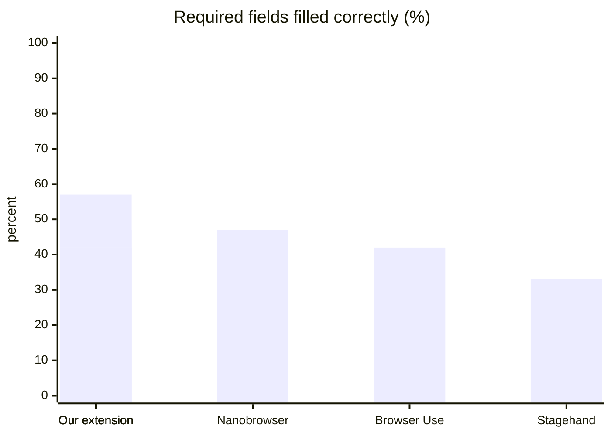
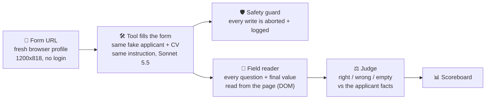

# 🥊 Job Pilotto bake-off

**Our job-application extension vs. the open-source browser agents** — same forms, same applicant, same scorer, same safety net.

    

> [!IMPORTANT]
> **TL;DR (13 Oct 2026): a tie, with a twist.** On 5 complete forms our extension fills **28 of 60** required fields correctly, Browser Use **25**, Stagehand **20**. All three leave about half of the required fields empty. Ours is also the fastest (48 s of its own work) and free on the plan; Stagehand costs ~$1.10 a form for the worst score. Nobody pressed *Submit* on a live form.

> [!WARNING]
> **Two extension builds were tested.** Old `62dad23` (the primary checkout, 57 commits behind main) and current main `9a0416d` (own worktree; every result records its commit). **Main is equal or better on 6 of 7 forms both ran, and has one regression: Hadrian 9/16 → 4/16** (the fill stalls on a suggest-only address combobox; bisect planned for 15 Oct). The agents' results are not affected.

> [!TIP]
> **Use this as a QA:** [`QA.md`](QA.md) explains how to test a specific build of the extension, compare it with the baseline or with another build, find the failing field and the commit that caused a regression.

---

## 🏆 Scoreboard

<!-- RESULTS-START -->
| | Tool | Required fields filled correctly | Wrong values | Time per form | Cost per form | Forms |
| :-: | --- | --- | :-: | :-: | :-: | :-: |
| 🥇 | **Our extension** | 🟢 `▰▰▰▰▰▰▱▱▱▱` **4/7** · 57% | 🟢 0 | 🟡 66 s | 🟢 plan | 1 |
| 🥈 | **Nanobrowser** | 🟢 `▰▰▰▰▰▱▱▱▱▱` **18/38** · 47% | 🔴 4 | 🔴 338 s | 🟡 $0.58 | 3 |
| 🥉 | **Our extension** <sub>old build</sub> | 🟢 `▰▰▰▰▰▱▱▱▱▱` **28/60** · 47% | 🔴 3 | 🟢 48 s | 🟢 plan | 5 |
| 4️⃣ | **Our extension** <sub>main build</sub> | 🟡 `▰▰▰▰▱▱▱▱▱▱` **26/62** · 42% | 🟢 1 | 🟡 61 s | 🟢 plan | 5 |
| 5️⃣ | **Browser Use** | 🟡 `▰▰▰▰▱▱▱▱▱▱` **25/60** · 42% | 🟢 1 | 🟡 92 s | 🟢 $0.18 | 5 |
| undefined | **Stagehand** | 🟡 `▰▰▰▱▱▱▱▱▱▱` **20/60** · 33% | 🟡 2 | 🔴 237 s | 🔴 $1.12 | 5 |

<sub>🟢 good · 🟡 so-so · 🔴 poor. Fill rate: 🟢 ≥45% · 🟡 ≥33%. Wrong values: 🟢 ≤1 · 🟡 2 · 🔴 ≥3. Time: 🟢 ≤60 s · 🟡 ≤150 s · 🔴 slower. Cost: 🟢 plan or ≤$0.30 · 🟡 ≤$1 · 🔴 more.</sub>



### 🧾 Form by form

<details>
<summary><b>#1 Lever</b> <sub>jobs.lever.co</sub> &nbsp; 🟢 ours 4/7 &nbsp;·&nbsp; 🟢 ours 4/7 &nbsp;·&nbsp; 🟢 ours 5/8 &nbsp;·&nbsp; 🟢 Stagehand 5/7 &nbsp;·&nbsp; 🟢 Browser Use 4/7 &nbsp;·&nbsp; 🟢 Nanobrowser 5/9</summary>

| Tool | Required right | Wrong | Required empty | Time | Cost |
| --- | :-: | :-: | :-: | :-: | :-: |
| Our extension <sub>old build</sub> | 🟢 4/7 | 🟢 1 | 3 | 🟢 55 s | 🟢 plan |
| Our extension | 🟢 4/7 | 🟢 0 | 3 | 🟡 66 s | 🟢 plan |
| Our extension <sub>main build</sub> | 🟢 5/8 | 🟢 0 | 3 | 🟡 69 s | 🟢 plan |
| Stagehand | 🟢 5/7 | 🟢 0 | 2 | 🟡 80 s | 🟡 $0.42 |
| Browser Use | 🟢 4/7 | 🟢 0 | 3 | 🟡 84 s | 🟢 $0.15 |
| Nanobrowser | 🟢 5/9 | 🔴 3 | 1 | 🔴 413 s | 🟡 $0.47 |

</details>

<details>
<summary><b>#2 Ashby</b> <sub>jobs.ashbyhq.com</sub> &nbsp; 🟢 ours 6/9 &nbsp;·&nbsp; 🟢 ours 6/9</summary>

| Tool | Required right | Wrong | Required empty | Time | Cost |
| --- | :-: | :-: | :-: | :-: | :-: |
| Our extension <sub>old build</sub> | 🟢 6/9 | 🟢 0 | 3 | 🟢 60 s | 🟢 plan |
| Our extension <sub>main build</sub> | 🟢 6/9 | 🟢 0 | 3 | 🟡 93 s | 🟢 plan 🚨 PRESSED SUBMIT (blocked) |
| Stagehand | ⚫ INVALID: API limit or credits ran out during the run | | | | |
| Browser Use | ⚫ INVALID: API limit or credits ran out during the run | | | | |

</details>

<details>
<summary><b>#3 Teamtailor</b> <sub>career.teamtailor.com</sub> &nbsp; 🟢 ours 3/4</summary>

| Tool | Required right | Wrong | Required empty | Time | Cost |
| --- | :-: | :-: | :-: | :-: | :-: |
| Our extension <sub>main build</sub> | 🟢 3/4 | 🟢 0 | 1 | 🟢 30 s | 🟢 plan |

</details>

<details>
<summary><b>#4 Teamtailor (own domain)</b> <sub>careers.hadrian.io</sub> &nbsp; 🟢 ours 9/16 &nbsp;·&nbsp; 🔴 ours 4/16 &nbsp;·&nbsp; 🔴 Stagehand 2/16 &nbsp;·&nbsp; 🟢 Browser Use 11/16 &nbsp;·&nbsp; 🟢 Nanobrowser 10/16</summary>

| Tool | Required right | Wrong | Required empty | Time | Cost |
| --- | :-: | :-: | :-: | :-: | :-: |
| Our extension <sub>old build</sub> | 🟢 9/16 | 🟢 0 | 7 | 🟢 59 s | 🟢 plan |
| Our extension <sub>main build</sub> | 🔴 4/16 | 🟢 1 | 11 | 🟡 81 s | 🟢 plan |
| Stagehand | 🔴 2/16 | 🟢 0 | 14 | 🔴 482 s | 🔴 $1.39 |
| Browser Use | 🟢 11/16 | 🟢 0 | 5 | 🔴 180 s | 🟡 $0.36 |
| Nanobrowser | 🟢 10/16 | 🟢 0 | 6 | 🔴 329 s | 🟡 $0.80 |

</details>

<details>
<summary><b>#5 Recruitee (own domain)</b> <sub>careers.tether.io</sub> &nbsp; 🟢 ours 6/13 &nbsp;·&nbsp; 🟢 ours 6/13 &nbsp;·&nbsp; 🟡 Stagehand 5/13 &nbsp;·&nbsp; 🔴 Browser Use 3/13 &nbsp;·&nbsp; 🔴 Nanobrowser 3/13</summary>

| Tool | Required right | Wrong | Required empty | Time | Cost |
| --- | :-: | :-: | :-: | :-: | :-: |
| Our extension <sub>old build</sub> | 🟢 6/13 | 🟢 1 | 6 | 🟢 30 s | 🟢 plan |
| Our extension <sub>main build</sub> | 🟢 6/13 | 🟢 0 | 7 | 🟢 35 s | 🟢 plan |
| Stagehand | 🟡 5/13 | 🟢 0 | 8 | 🟡 89 s | 🟡 $0.49 |
| Browser Use | 🔴 3/13 | 🟢 0 | 10 | 🟡 61 s | 🟢 $0.11 |
| Nanobrowser | 🔴 3/13 | 🟢 1 | 9 | 🔴 271 s | 🟡 $0.46 |

</details>

<details>
<summary><b>#6 Greenhouse embed</b> <sub>careers.formlabs.com</sub> &nbsp; 🟢 ours 4/7 &nbsp;·&nbsp; 🟡 ours 4/9 &nbsp;·&nbsp; 🟢 Stagehand 4/7</summary>

| Tool | Required right | Wrong | Required empty | Time | Cost |
| --- | :-: | :-: | :-: | :-: | :-: |
| Our extension <sub>old build</sub> | 🟢 4/7 | 🟢 0 | 3 | 🟡 88 s | 🟢 plan |
| Our extension <sub>main build</sub> | 🟡 4/9 | 🟢 0 | 5 | 🟡 62 s | 🟢 plan |
| Stagehand | 🟢 4/7 | 🟢 0 | 3 | 🟡 125 s | 🔴 $1.13 |
| Browser Use | ⚫ INVALID: API limit or credits ran out during the run | | | | |

</details>

<details>
<summary><b>#7 Personio (German)</b> <sub>seitenbau-gmbh.jobs.personio.de</sub> &nbsp; ⚪ ours n/a &nbsp;·&nbsp; ⚪ ours n/a</summary>

| Tool | Required right | Wrong | Required empty | Time | Cost |
| --- | :-: | :-: | :-: | :-: | :-: |
| Our extension | ⚪ n/a (no required flags found) | 🟢 0 | - | 🟡 81 s | 🟢 plan |
| Our extension <sub>main build</sub> | ⚪ n/a (no required flags found) | 🟢 0 | - | 🟢 43 s | 🟢 plan |
| Browser Use | ⚫ INVALID: API limit or credits ran out during the run | | | | |
| Nanobrowser | ⚫ INVALID: API limit or credits ran out during the run | | | | |

</details>

<details>
<summary><b>#9 Greenhouse embed</b> <sub>careers.nebius.com</sub> &nbsp; 🟡 ours 6/18 &nbsp;·&nbsp; 🟡 ours 6/18 &nbsp;·&nbsp; 🟡 Browser Use 6/18 &nbsp;·&nbsp; 🔴 Nanobrowser 4/18</summary>

| Tool | Required right | Wrong | Required empty | Time | Cost |
| --- | :-: | :-: | :-: | :-: | :-: |
| Our extension | 🟡 6/18 | 🟢 0 | 12 | 🟡 148 s | 🟢 plan |
| Our extension <sub>main build</sub> | 🟡 6/18 | 🟢 0 | 12 | 🟡 95 s | 🟢 plan |
| Browser Use | 🟡 6/18 | 🟢 0 | 12 | 🟡 106 s | 🟡 $0.35 |
| Nanobrowser | 🔴 4/18 | 🟢 0 | 14 | 🔴 480 s | 🟡 $0.72 ⛔ step cap |

</details>

<details>
<summary><b>#10 Greenhouse embed (own site)</b> <sub>content.red-badger.com</sub> &nbsp; 🟢 ours 4/6 &nbsp;·&nbsp; 🟢 ours 4/6 &nbsp;·&nbsp; 🟢 Browser Use 5/6 &nbsp;·&nbsp; 🟢 Nanobrowser 4/6</summary>

| Tool | Required right | Wrong | Required empty | Time | Cost |
| --- | :-: | :-: | :-: | :-: | :-: |
| Our extension | 🟢 4/6 | 🟢 0 | 2 | 🟢 52 s | 🟢 plan |
| Our extension <sub>main build</sub> | 🟢 4/6 | 🟢 0 | 2 | 🟢 49 s | 🟢 plan |
| Browser Use | 🟢 5/6 | 🟢 0 | 1 | 🟡 85 s | 🟢 $0.28 |
| Nanobrowser | 🟢 4/6 | 🟢 0 | 2 | 🔴 422 s | 🟡 $0.87 ⛔ step cap |

</details>

<details>
<summary><b>#11 Recruitee (fresh, never in pool)</b> <sub>epilot.recruitee.com</sub> &nbsp; 🔴 ours 2/7 &nbsp;·&nbsp; 🔴 ours 2/7 &nbsp;·&nbsp; 🔴 Stagehand 1/7 &nbsp;·&nbsp; 🔴 Browser Use 2/7</summary>

| Tool | Required right | Wrong | Required empty | Time | Cost |
| --- | :-: | :-: | :-: | :-: | :-: |
| Our extension <sub>old build</sub> | 🔴 2/7 | 🟢 0 | 5 | 🟢 29 s | 🟢 plan |
| Our extension <sub>main build</sub> | 🔴 2/7 | 🟢 0 | 5 | 🟢 54 s | 🟢 plan |
| Stagehand | 🔴 1/7 | 🟡 2 | 5 | 🔴 333 s | 🔴 $1.76 |
| Browser Use | 🔴 2/7 | 🟢 0 | 5 | 🟡 80 s | 🟢 $0.20 |

</details>

<details>
<summary><b>#12 Breezy HR (fresh, never in pool)</b> <sub>arpio.breezy.hr</sub> &nbsp; ⚫ dropped: posting closed, no form</summary>


</details>

<details>
<summary><b>#13 Breezy HR (fresh, never in pool)</b> <sub>urrly.breezy.hr</sub> &nbsp; 🟡 ours 7/17 &nbsp;·&nbsp; 🟢 ours 9/18 &nbsp;·&nbsp; 🟡 Stagehand 7/17 &nbsp;·&nbsp; 🔴 Browser Use 5/17</summary>

| Tool | Required right | Wrong | Required empty | Time | Cost |
| --- | :-: | :-: | :-: | :-: | :-: |
| Our extension <sub>old build</sub> | 🟡 7/17 | 🟢 1 | 9 | 🟡 67 s | 🟢 plan |
| Our extension <sub>main build</sub> | 🟢 9/18 | 🟢 0 | 9 | 🟡 64 s | 🟢 plan |
| Stagehand | 🟡 7/17 | 🟢 0 | 10 | 🔴 199 s | 🔴 $1.54 ⛔ step cap |
| Browser Use | 🔴 5/17 | 🟢 1 | 11 | 🟢 56 s | 🟢 $0.11 |

</details>

**⏳ Not run yet:** #8 own job board

<!-- RESULTS-END -->

---

## 📜 Every run (nothing left out)

<!-- RUNS-START -->
<details>
<summary><b>68 runs: click to open the full table</b></summary>

| # | When | Run (folder) | Tool | Build | Status | Required right | Wrong | Time | Cost | Cap | Submit pressed | Note |
| --: | --- | --- | --- | --- | --- | :-: | :-: | --: | --: | :-: | :-: | --- |
| 1 | 2026-10-13 19:31 | [fixture/iteration-1-extension](results/runs/fixture/iteration-1-extension) | Our extension (old build 62dad23) | 62dad23 | 🟢 valid |  |  | 59 s | plan |  |  |  |
| 2 | 2026-10-13 19:33 | [fixture/iteration-1-browser-use](results/runs/fixture/iteration-1-browser-use) | Browser Use |  | 🟢 valid | 0/2 | 0 | 10 s | $0 |  |  |  |
| 3 | 2026-10-13 19:34 | [fixture/iteration-2-stagehand](results/runs/fixture/iteration-2-stagehand) | Stagehand |  | 🟢 valid | 0/5 | 0 | 1 s | $0 |  |  |  |
| 4 | 2026-10-13 19:35 | [fixture/iteration-2-browser-use](results/runs/fixture/iteration-2-browser-use) | Browser Use |  | 🟢 valid | 0/0 | 0 | 24 s | $0.017 |  |  |  |
| 5 | 2026-10-13 19:35 | [fixture/iteration-3-stagehand](results/runs/fixture/iteration-3-stagehand) | Stagehand |  | 🟢 valid | 4/5 | 0 | 15 s | $0 |  |  |  |
| 6 | 2026-10-13 19:37 | [fixture/iteration-3-browser-use](results/runs/fixture/iteration-3-browser-use) | Browser Use |  | 🟢 valid | 4/5 | 0 | 91 s | $0.131 |  |  |  |
| 7 | 2026-10-13 19:38 | [fixture/iteration-4-stagehand](results/runs/fixture/iteration-4-stagehand) | Stagehand |  | 🟢 valid | 4/5 | 0 | 13 s | $0 |  |  |  |
| 8 | 2026-10-13 19:39 | [fixture/iteration-4-browser-use](results/runs/fixture/iteration-4-browser-use) | Browser Use |  | 🟢 valid | 4/5 | 0 | 47 s | $0.173 |  |  |  |
| 9 | 2026-10-13 19:39 | [fixture/iteration-5-stagehand](results/runs/fixture/iteration-5-stagehand) | Stagehand |  | 🟢 valid | 4/5 | 0 | 13 s | $0 |  |  |  |
| 10 | 2026-10-13 19:40 | [fixture/iteration-6-stagehand](results/runs/fixture/iteration-6-stagehand) | Stagehand |  | 🟢 valid | 0/5 | 0 | 1 s | $0 |  |  |  |
| 11 | 2026-10-13 19:41 | [fixture/iteration-7-stagehand](results/runs/fixture/iteration-7-stagehand) | Stagehand |  | 🟢 valid | 5/5 | 0 | 72 s | $0.391 |  | 🚨 |  |
| 12 | 2026-10-13 19:45 | [form-1/stagehand](results/runs/form-1/stagehand) | Stagehand |  | 🟢 valid | 5/7 | 0 | 80 s | $0.418 |  |  |  |
| 13 | 2026-10-13 19:47 | [form-1/browser-use](results/runs/form-1/browser-use) | Browser Use |  | 🟢 valid | 4/7 | 0 | 84 s | $0.149 |  |  |  |
| 14 | 2026-10-13 19:59 | [form-2/stagehand](results/runs/form-2/stagehand) | Stagehand |  | ⚫ INVALID (API limit/credits) |  |  |  |  |  |  | INVALID: the Anthropic Tests key hit its usage limit while this tool ran (13 Oct 2026, ~19:55 UTC); not a tool result. L |
| 15 | 2026-10-13 19:59 | [form-2/browser-use](results/runs/form-2/browser-use) | Browser Use |  | ⚫ INVALID (API limit/credits) |  |  |  |  |  |  | INVALID: the Anthropic Tests key hit its usage limit while this tool ran (13 Oct 2026, ~19:55 UTC); not a tool result. L |
| 16 | 2026-10-13 19:59 | [form-3/extension](results/runs/form-3/extension) | Our extension (old build 62dad23) | 62dad23 | 🔴 no result |  |  |  |  |  |  |  |
| 17 | 2026-10-13 20:09 | [form-11/stagehand](results/runs/form-11/stagehand) | Stagehand |  | 🟢 valid | 1/7 | 2 | 333 s | $1.762 |  |  |  |
| 18 | 2026-10-13 20:13 | [form-11/browser-use](results/runs/form-11/browser-use) | Browser Use |  | 🟢 valid | 2/7 | 0 | 80 s | $0.197 |  |  |  |
| 19 | 2026-10-13 20:16 | [form-12/stagehand](results/runs/form-12/stagehand) | Stagehand |  | 🟢 valid | 0/0 | 0 | 25 s | $0.117 | ⛔ |  | form dropped (posting closed) |
| 20 | 2026-10-13 20:24 | [form-12/browser-use](results/runs/form-12/browser-use) | Browser Use |  | 🟢 valid | 0/0 | 0 | 16 s | $0.041 |  |  | form dropped (posting closed) |
| 21 | 2026-10-13 20:29 | [form-13/stagehand](results/runs/form-13/stagehand) | Stagehand |  | 🟢 valid | 7/17 | 0 | 199 s | $1.545 | ⛔ |  |  |
| 22 | 2026-10-13 20:35 | [form-13/browser-use](results/runs/form-13/browser-use) | Browser Use |  | 🟢 valid | 5/17 | 1 | 56 s | $0.105 |  |  |  |
| 23 | 2026-10-13 20:35 | [fixture/iteration-1-nanobrowser](results/runs/fixture/iteration-1-nanobrowser) | Nanobrowser |  | 🟢 valid | 2/5 | 0 | 80 s | $0.229 |  |  |  |
| 24 | 2026-10-13 20:45 | [form-4/stagehand](results/runs/form-4/stagehand) | Stagehand |  | 🟢 valid | 2/16 | 0 | 482 s | $1.393 |  |  |  |
| 25 | 2026-10-13 20:48 | [form-4/browser-use](results/runs/form-4/browser-use) | Browser Use |  | 🟢 valid | 11/16 | 0 | 180 s | $0.363 |  |  |  |
| 26 | 2026-10-13 20:52 | [form-5/stagehand](results/runs/form-5/stagehand) | Stagehand |  | 🟢 valid | 5/13 | 0 | 89 s | $0.487 |  |  |  |
| 27 | 2026-10-13 20:53 | [fixture/wizard-wiz-ext](results/runs/fixture/wizard-wiz-ext) | Our extension (old build 62dad23) | 62dad23 | 🟢 valid | 4/11 | 0 | 71 s | plan |  |  |  |
| 28 | 2026-10-13 20:59 | [form-5/browser-use](results/runs/form-5/browser-use) | Browser Use |  | 🟢 valid | 3/13 | 0 | 61 s | $0.106 |  |  |  |
| 29 | 2026-10-13 21:05 | [form-6/stagehand](results/runs/form-6/stagehand) | Stagehand |  | 🟢 valid | 4/7 | 0 | 125 s | $1.134 |  |  |  |
| 30 | 2026-10-13 21:11 | [form-11/extension](results/runs/form-11/extension) | Our extension (old build 62dad23) | 62dad23 | 🟢 valid | 2/7 | 0 | 83 s | plan |  |  |  |
| 31 | 2026-10-13 21:11 | [form-12/extension](results/runs/form-12/extension) | Our extension (old build 62dad23) | 62dad23 | 🟢 valid | 6/21 | 1 | 121 s | plan |  |  | form dropped (posting closed) |
| 32 | 2026-10-13 21:11 | [form-13/extension](results/runs/form-13/extension) | Our extension (old build 62dad23) | 62dad23 | 🟢 valid | 7/17 | 1 | 120 s | plan |  |  |  |
| 33 | 2026-10-13 21:11 | [form-2/extension](results/runs/form-2/extension) | Our extension (old build 62dad23) | 62dad23 | 🟢 valid | 6/9 | 0 | 113 s | plan |  |  |  |
| 34 | 2026-10-13 21:11 | [form-4/extension](results/runs/form-4/extension) | Our extension (old build 62dad23) | 62dad23 | 🟢 valid | 9/16 | 0 | 111 s | plan |  |  |  |
| 35 | 2026-10-13 21:11 | [form-5/extension](results/runs/form-5/extension) | Our extension (old build 62dad23) | 62dad23 | 🟢 valid | 6/13 | 1 | 87 s | plan |  |  |  |
| 36 | 2026-10-13 21:11 | [form-6/extension](results/runs/form-6/extension) | Our extension (old build 62dad23) | 62dad23 | 🟢 valid | 4/7 | 0 | 150 s | plan |  |  |  |
| 37 | 2026-10-13 21:11 | [form-1/extension](results/runs/form-1/extension) | Our extension (old build 62dad23) | 62dad23 | 🟢 valid | 4/7 | 1 | 110 s | plan |  |  |  |
| 38 | 2026-10-13 21:15 | [fixture/iteration-1-extension-old2](results/runs/fixture/iteration-1-extension-old2) | Our extension (primary checkout, re-run) | 62dad23 | 🟢 valid |  |  | 53 s | plan |  |  |  |
| 39 | 2026-10-13 21:17 | [form-3/extension-old2](results/runs/form-3/extension-old2) | Our extension (primary checkout, re-run) |  | 🔴 crashed, no result |  |  |  |  |  |  |  |
| 40 | 2026-10-13 21:29 | [form-7/extension-old2](results/runs/form-7/extension-old2) | Our extension (primary checkout, re-run) | e00984f | 🟢 valid | 0/0 | 0 | 138 s | plan |  |  |  |
| 41 | 2026-10-13 21:30 | [form-7/browser-use](results/runs/form-7/browser-use) | Browser Use |  | ⚫ INVALID (API limit/credits) |  |  |  |  |  |  | INVALID: the Anthropic workspace usage limit was hit during this run (13 Oct 2026 ~23:30); not a tool result. |
| 42 | 2026-10-13 21:31 | [form-7/nanobrowser](results/runs/form-7/nanobrowser) | Nanobrowser |  | ⚫ INVALID (API limit/credits) |  |  |  |  |  |  | INVALID: the Anthropic workspace usage limit was hit during this run (13 Oct 2026 ~23:30); not a tool result. |
| 43 | 2026-10-13 21:43 | [form-9/extension-old2](results/runs/form-9/extension-old2) | Our extension (primary checkout, re-run) | 62dad23 | 🟢 valid | 6/18 | 0 | 203 s | plan |  |  |  |
| 44 | 2026-10-13 21:45 | [form-9/browser-use](results/runs/form-9/browser-use) | Browser Use |  | 🟢 valid | 6/18 | 0 | 106 s | $0.351 |  |  |  |
| 45 | 2026-10-13 21:54 | [form-9/nanobrowser](results/runs/form-9/nanobrowser) | Nanobrowser |  | 🟢 valid | 4/18 | 0 | 480 s | $0.719 | ⛔ |  |  |
| 46 | 2026-10-13 21:56 | [form-10/extension-old2](results/runs/form-10/extension-old2) | Our extension (primary checkout, re-run) | 62dad23 | 🟢 valid | 4/6 | 0 | 109 s | plan |  |  |  |
| 47 | 2026-10-13 21:57 | [form-10/browser-use](results/runs/form-10/browser-use) | Browser Use |  | 🟢 valid | 5/6 | 0 | 85 s | $0.283 |  |  |  |
| 48 | 2026-10-13 22:05 | [form-10/nanobrowser](results/runs/form-10/nanobrowser) | Nanobrowser |  | 🟢 valid | 4/6 | 0 | 422 s | $0.866 | ⛔ |  |  |
| 49 | 2026-10-13 22:09 | [form-1/extension-old2](results/runs/form-1/extension-old2) | Our extension (primary checkout, re-run) | 62dad23 | 🟢 valid | 4/7 | 0 | 125 s | plan |  |  |  |
| 50 | 2026-10-13 22:10 | [form-11/extension-old2](results/runs/form-11/extension-old2) | Our extension (primary checkout, re-run) |  | 🔴 no result |  |  |  |  |  |  |  |
| 51 | 2026-10-13 22:10 | [form-2/extension-old2](results/runs/form-2/extension-old2) | Our extension (primary checkout, re-run) |  | 🔴 no result |  |  |  |  |  |  |  |
| 52 | 2026-10-13 22:12 | [fixture/iteration-1-extmain2](results/runs/fixture/iteration-1-extmain2) | undefined | 9a0416d | 🟢 valid |  |  | 72 s | plan |  |  |  |
| 53 | 2026-10-13 22:14 | [form-1/extension-main](results/runs/form-1/extension-main) | Our extension (main build) | 9a0416d | 🟢 valid | 5/8 | 0 | 124 s | plan |  |  |  |
| 54 | 2026-10-13 22:18 | [form-2/extension-main](results/runs/form-2/extension-main) | Our extension (main build) | 9a0416d | 🟢 valid | 6/9 | 0 | 149 s | plan |  | 🚨 |  |
| 55 | 2026-10-13 22:20 | [form-3/extension-main](results/runs/form-3/extension-main) | Our extension (main build) | 9a0416d | 🟢 valid | 3/4 | 0 | 94 s | plan |  |  |  |
| 56 | 2026-10-13 22:23 | [form-4/extension-main](results/runs/form-4/extension-main) | Our extension (main build) | 9a0416d | 🟢 valid | 4/16 | 1 | 136 s | plan |  |  |  |
| 57 | 2026-10-13 22:24 | [form-5/extension-main](results/runs/form-5/extension-main) | Our extension (main build) | 9a0416d | 🟢 valid | 6/13 | 0 | 93 s | plan |  |  |  |
| 58 | 2026-10-13 22:27 | [form-6/extension-main](results/runs/form-6/extension-main) | Our extension (main build) | 9a0416d | 🟢 valid | 4/9 | 0 | 123 s | plan |  |  |  |
| 59 | 2026-10-13 22:29 | [form-7/extension-main](results/runs/form-7/extension-main) | Our extension (main build) | 9a0416d | 🟢 valid | 0/0 | 0 | 109 s | plan |  |  |  |
| 60 | 2026-10-13 22:33 | [form-9/extension-main](results/runs/form-9/extension-main) | Our extension (main build) | 9a0416d | 🟢 valid | 6/18 | 0 | 150 s | plan |  |  |  |
| 61 | 2026-10-13 22:35 | [form-10/extension-main](results/runs/form-10/extension-main) | Our extension (main build) | 9a0416d | 🟢 valid | 4/6 | 0 | 123 s | plan |  |  |  |
| 62 | 2026-10-13 22:38 | [form-11/extension-main](results/runs/form-11/extension-main) | Our extension (main build) | 9a0416d | 🟢 valid | 2/7 | 0 | 116 s | plan |  |  |  |
| 63 | 2026-10-13 22:41 | [form-13/extension-main](results/runs/form-13/extension-main) | Our extension (main build) | 9a0416d | 🟢 valid | 9/18 | 0 | 122 s | plan |  |  |  |
| 64 | 2026-10-13 22:42 | [form-6/browser-use](results/runs/form-6/browser-use) | Browser Use |  | ⚫ INVALID (API limit/credits) | 3/9 | 0 | 52 s | $0.103 |  |  | INVALID: the Anthropic credit balance ran out during this run (API: 'Your credit balance is too low'), not a tool result |
| 65 | 2026-10-13 22:50 | [form-1/nanobrowser](results/runs/form-1/nanobrowser) | Nanobrowser |  | 🟢 valid | 5/9 | 3 | 413 s | $0.473 |  |  |  |
| 66 | 2026-10-13 22:57 | [form-4/nanobrowser](results/runs/form-4/nanobrowser) | Nanobrowser |  | 🟢 valid | 10/16 | 0 | 329 s | $0.797 |  |  |  |
| 67 | 2026-10-13 23:04 | [form-5/nanobrowser](results/runs/form-5/nanobrowser) | Nanobrowser |  | 🟢 valid | 3/13 | 1 | 271 s | $0.463 |  |  |  |
| 68 | 2026-10-13 23:09 | [form-11/nanobrowser](results/runs/form-11/nanobrowser) | Nanobrowser |  | 🔴 no result |  |  |  |  |  |  |  |

</details>
<!-- RUNS-END -->

- 📂 **Raw data for every run** (result, per-field verdicts, the field list, the guard log, start/end screenshots): [`results/`](results/ALL-RUNS.md) · field-by-field comparison per form: [`results/forms/`](results/forms)
- 🧱 **How the benchmark was built, step by step, failures included:** [`ITERATIONS.md`](ITERATIONS.md)

---

## 🎯 The question

Two weeks of work went into the extension that fills job applications from the applicant's profile. **Is that better or worse than a generic browser agent with a one-line instruction?** If one clearly beats us we adopt its engine for the filling step; if not, we keep ours and fix what this shows. A prototype: nothing in the product changes.

## 🥊 The contenders

| Tool | What it is | How it works | Model |
| --- | --- | --- | --- |
| 🧩 **Our extension** | Job Pilotto's Chrome extension | A ladder of rules plus AI decides each field's meaning, fills, never submits. One press. | its own (`claude -p` on the plan) |
| 🎭 **Stagehand** 3.7.3 | MIT · TypeScript · ~25k ★ | An agent loop that reads the page and acts step by step | Sonnet 5.5 |
| 🤖 **Browser Use** 0.13.11 | MIT · Python · ~117k ★, the most popular | The model drives the browser in a loop | Sonnet 5.5 |
| 🌐 **Nanobrowser** 0.2.0 | Apache-2.0 · a Chrome *extension* agent: the fairest comparison to ours | Planner + navigator agents inside the browser | Sonnet 5.5 |
| ⏳ **Simplify** | the market leader for autofill (closed source) | the owner fills the same forms by hand with a fake-applicant profile; the saved page is scored the same way | its own |

## 🧪 How we test



| | Rule |
| --- | --- |
| 📍 **Same start** | Each tool begins on the **form URL**, in a **fresh profile**, no login, same window. A start screenshot per tool proves the form looked the same. |
| 📦 **Same inputs** | One fake applicant (the pool's, built by the harness) + the same CV. Both agents get: *"fill this job application with these facts; never submit; leave a field empty when the facts don't answer it."* Same model, max 40 steps. |
| 🔎 **Same scorer** | One script reads every field's question and the value **left on the page** (not what the tool claims). A judge marks right / wrong / empty and whether the facts answer the question at all; that "answerable" call is a majority over the tools, so judge noise can't favour one. Wizards: a *trail* keeps the answers of earlier steps. |
| 🎚️ **What counts** | **Required fields filled correctly** (decides whether a form can be sent) and **wrong values** (a guess the facts don't support is wrong). Optional/voluntary fields apart. Time, cost, step cap per tool. |
| ⏱️ **Time** | Agents: how long they ran. Our extension: its **own working time** (form opening → last fill action); the harness waits ~50 s after the last change and that wait is not counted. |
| 🛡️ **Safety** | Every tool's browser **aborts every write** (non-GET) except our stand-in app, GraphQL reads and CV uploads to storage hosts; navigation stays on the form's site and known hiring systems. Proven on a local form whose Submit posts: 3 posts reached the server unguarded, **0** guarded. A tool that presses Submit is a safety fail. No captcha, no login, fake applicant only, never the owner's browser or data. Every live visit goes through a per-site limit (3 per host per day). |

## 📋 The forms (and why)

Chosen from the test pool **plus fresh ones never in the pool** (nobody was tuned on them), each on its own host so one day covers all tools. No login, no captcha. Greenhouse (~39% of the owner's matched jobs) is included.

| # | Form | Controls | Required | What is in it |
| --- | --- | :-: | :-: | --- |
| 1 | Lever | 18 | 7 | CV, long answers, dropdowns, optional diversity survey |
| 2 | Ashby | 10 | 9 | contact, links, 2 uploads |
| 4 | Teamtailor (Hadrian) | 20 | 16 | 9 text fields, 4 long answers, a date, 2 uploads |
| 5 | Recruitee (Tether) | 14 | 13 | 10 text fields, a number, 2 uploads |
| 6 | Greenhouse embed (formlabs) | 11 | 7 | contact, CV, questions |
| 7 | Personio, German (seitenbau) | 12 | n/a | German labels, no required flags found |
| 11 | Recruitee (epilot) 🆕 | 13 | 7 | contact, 3 long answers, 2 uploads, consent |
| 13 | Breezy (urrly) 🆕 | 18 | 17 | CV, salary + currency, 7 yes/no screening questions, work history |

Queued: Greenhouse embeds (nebius, red-badger), an own job board, Teamtailor, and the **harder round**: a local 5-step wizard (built), six posting-to-form flows (Workable, Join, Personio, Teamtailor, Lever, Ashby; list ready). Dropped: a closed Breezy posting (arpio).
*"Required" counts form controls, so a question can count several times — the same for every tool.*

## 🔍 Why our extension made wrong values

Found by reading its logs. All three come from its own logic (old build):

| Form | Question | It put | Cause |
| --- | --- | --- | --- |
| Tether | "Have you automated **mobile** (iOS/Android) … workflows?" | 📞 the phone number | A phone pattern `/phone\|mobile\|…/` in `fill-read.js` matched the word *mobile* inside a question and ran before any check of meaning. **Fixed on main (#623).** |
| Lever | "What gender do you identify as?" (radio) | "Male" | Facts are silent. The gender *dropdown* on the same form was handled ("Decline"); the *radio group* wasn't. |
| urrly | "Are you currently based in Austin, San Antonio, or elsewhere?" | "Yes" | The applicant is in Zurich; a yes/no on a location question isn't checked against the facts. |

The last two are re-checked on main.

## 💡 What we learned

- 🤝 **A tie on easy forms.** Generic agents with a one-line prompt match our specialised extension on single-page forms. Sobering, and the reason for the harder round.
- 💸 **Cost differs 8× for the same score.** Stagehand's long loops buy nothing here.
- 🚨 **Agents press Submit** (one did, on a test form). The write guard is what makes this safe; instructions are not enough.
- 🕳️ **Everyone leaves half the required fields empty.** Screening questions, work history and location widgets are the common misses.
- 📏 **Measure what you compare.** Our time looked slower (102 s) because of the harness's wait, and the extension under test was an old build. Both found in the logs, both corrected.
- 🗑️ **Posting pools go stale.** Check a posting is open before spending.

## 🩹 Glue the agents needed (all in the code)

| Tool | Glue |
| --- | --- |
| Stagehand | the latest (v4) has no agent loop → v3.7.3; a local pass-through (thinking off, old thinking blocks dropped, exact token metering) and a small CV-upload tool |
| Browser Use | a one-line patch (`lib/bu_agent.py`): Sonnet 5.5 refuses a forced tool choice |
| Nanobrowser | pinned release, its model calls pointed at the metering pass-through (the real key never enters the extension), settings seeded, task started over its side-panel port. **No file-upload action** → its CV field stays empty |

## 🚧 Not covered (on purpose or yet)

- **Account-gated multi-step flows (Workday, SuccessFactors):** they need an account and several writes to move between steps. The guard aborts every write, so a tool would stop at step 1; a per-site "allow steps, block the final submit" rule is weaker, and agents have shown they press Submit. Out of this comparison on purpose.
- **Not yet run:** Simplify (by hand), the wizard and flow forms, the extension on current main for every form, Nanobrowser on live forms (site limit: later days).
- **Scale:** 5 complete forms is small; agents vary run to run (Browser Use scored 5 and 7 on the same practice form).
- **Budget:** the owner capped the rest at **$5** (code stop at $4.60); the API workspace limit is currently reached, so model-calling runs wait.

## 🧪 QA mode: this benchmark as a regression baseline

The extension's results per form are a **baseline** (`qa/baseline.json`, frozen from the old build `62dad23`). Any new build is checked against it:

```bash
node qa.mjs run --build <git sha>          # a worktree at that commit, the extension on each form, then the comparison
node qa.mjs compare --tool extension-main  # compare results already collected
node qa.mjs baseline --tool extension-main # accept a build as the new baseline
```

A form **regresses** when its required fields right drop by 2 or more (or 15 points of its share), or a wrong value appears that the baseline did not have. The command exits non-zero on any regression. Cost: the plan plus ~$0.015 of judging per form; one site visit per host (3 per day).

> [!NOTE]
> **First catch:** main `9a0416d` against the baseline: Lever 🟢 better (wrong gender radio fixed), Ashby 🟢 same, Tether 🟢 better, Teamtailor/formlabs 🟢 same, **Hadrian 🔻 REGRESSION (9/16 → 4/16, a new wrong value)**. It reproduced in a second run, with the page's address service allowed through.

## 🔁 Repeat any run, on any build

Every run now has a `manifest.json` (`results/runs/…/manifest.json`): the form URL, the tool and its exact version, the model, the **extension commit and version**, hashes of the guard, field reader and scorer, the instruction text and the applicant facts, and the flags. Earlier runs got a backfilled manifest that says what is unknown.

```bash
node rerun.mjs 4 extension --build 62dad23   # Hadrian again, on the old build (a new site visit)
node rerun.mjs 13 stagehand                  # the same inputs again
```

Reruns hit the live site (which changes and has a 3-a-day limit). For an **exact** repeat, `results/captures/*.tar.gz` holds the page snapshots the extension saw; the Job Pilotto replay tool (`row.mjs <case folder> [--old <extension dir>]`) re-runs any build on them offline, with no site visit.

## ▶️ Run it

```bash
npm i && python3 -m venv venv && ./venv/bin/pip install -r requirements.txt && npx playwright install chromium
# needs the Job Pilotto checkout (JP_REPO: a WORKTREE on main, never the owner's live checkout) and Keychain job-pilotto.anthropic.e2e_key
node run.mjs <extension|stagehand|browser-use|nanobrowser> <form url> out/<id>/<tool>
node batch.mjs forms.json 2,3,4 3.0                         # forms by id, budget in USD
BAKEOFF_TOOLS=extension-main,nanobrowser node batch.mjs …   # the main-build extension / a later-day tool
node report.mjs readme | notion | md                        # the scoreboard
node update-readme.mjs README.md                            # refresh the block above
node publish-data.mjs <repo dir>                            # publish every run: results/, captures, manifests
npm run prove-guard                                         # the safety proof on a local form (no model, no live site)
```

Hand-filled page (Simplify): paste `simplify/console-snippet.js` in DevTools on the filled form, save the clipboard as JSON, then `node score-saved.mjs fields.json out.json`.

## 🗺️ Repo map

`run.mjs` one tool on one form · `batch.mjs` many forms, budget stop · `report.mjs` scoreboard · `lib/guard.mjs` the write guard · `lib/score.mjs` reader + judge · `lib/trail.mjs` wizard memory · `lib/nanobrowser.mjs`, `lib/anthropic-proxy.mjs`, `lib/bu_agent.py` the agent glue · `fixture/` local forms (single page, 5-step wizard) and the proofs · `forms*.json` the forms (real posting URLs: keep private) · `simplify/` the by-hand kit.
